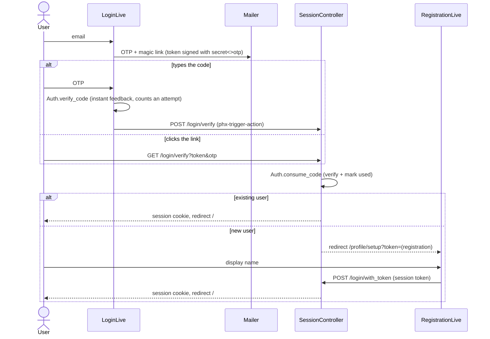
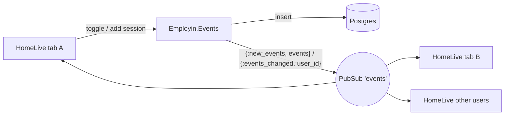

# Architecture

Employin is a standard Phoenix application. The domain code (`lib/employin`) knows
nothing about the web, and the web layer (`lib/employin_web`) is a thin LiveView
UI on top of it.

## Module map

```
lib/
├── employin/                       # domain
│   ├── contexts/
│   │   ├── events.ex               # Employin.Events: queries, commands, PubSub
│   │   ├── events/event.ex         # schema + session form changeset
│   │   ├── users.ex                # Employin.Users
│   │   └── users/user.ex           # schema, email/display-name validation
│   ├── auth.ex                     # login rules: rate limits, single-use tokens
│   ├── login_token.ex              # purpose-bound signed/encrypted tokens + OTP
│   ├── rate_limit.ex               # Hammer (ETS) fixed-window limiter
│   ├── reports.ex                  # worked time per user per local day
│   ├── time_zones.ex               # IANA zone conversions (tz database)
│   ├── mail_notifier.ex            # login email (HTML + text)
│   ├── schema.ex                   # UUIDv7 primary keys, utc_datetime timestamps
│   └── release.ex                  # `bin/migrate` for releases
└── employin_web/                   # web
    ├── router.ex                   # live_sessions :guest / :authenticated
    ├── user_auth.ex                # plugs + on_mount hooks
    ├── controllers/
    │   ├── session_controller.ex   # turns verified tokens into a session
    │   └── report_controller.ex    # CSV export
    ├── components/
    │   ├── core_components.ex      # inputs, modal, flash, icon, spinner, status_dot
    │   ├── auth_components.ex      # auth_card, submit_button
    │   └── layouts.ex              # root/app layouts + app_header navigation
    └── live/
        ├── home/                   # HomeLive, HomeComponents, ActivityLog (stream)
        ├── reports/                # ReportsLive (week/month table)
        ├── login/                  # LoginLive (email → OTP)
        └── registration/           # RegistrationLive (display name)
assets/js/
├── app.js                          # LiveSocket, sends the browser's IANA time zone
└── hooks/                          # ActivityLog, OtpCountdown, AutoDismissFlash
```

## Authentication flow

Login is passwordless. `Employin.LoginToken` signs tokens with `Phoenix.Token`.
Each token is bound to a purpose by its salt, so a token issued for one step
can't be replayed in another. The only server-side state is in
`Employin.Auth`, which adds:

- **Rate limits** (`Employin.RateLimit`, Hammer on ETS): 5 login emails per
  address per 15 minutes, and 5 code guesses per issued token per 5 minutes.
  The keys are the email and the token, not the IP address, which would be
  shared by everyone behind a reverse proxy. The limiter is node-local; a
  multi-node deployment would need a shared backend such as Redis.
- **Single-use links**: when a login link or post-registration token is
  consumed, its SHA-256 goes into `used_login_tokens`, and later uses are
  rejected. Rows older than the token lifetime are pruned on write.

| Purpose         | Payload | Lifetime | Notes |
|-----------------|---------|----------|-------|
| `:otp`          | email   | 5 min    | Signing key is `secret <> otp`, so the token verifies only with the emailed code |
| `:registration` | email   | 10 min   | Proves the email was verified; carried to the profile setup page |
| `:session`      | user id | 60 s     | Hands a new user from the LiveView to the controller to set the cookie |
| `:pending`      | email, OTP token, sent-at | 5 min | **Encrypted** state of the OTP step, kept in the login URL (`/login?s=…`) so a refresh keeps the user on that step |



The session stores only `user_id`. `UserAuth` resolves it in a plug for controllers
and in `on_mount` for LiveViews, so a deleted user can no longer use the app.
Logout is a `DELETE` request. It clears the session and broadcasts `disconnect`
to the user's open LiveViews.

`LoginLive.handle_params/3` alone decides which step to show: no `s` param
means the email step, and a valid `:pending` token means the OTP step. Sending or
resending a code `push_patch`es a fresh token. The resend cooldown
(`@resend_cooldown`) is measured from the token's sent-at time, so the server
still enforces it after a refresh, and the JS countdown resumes where it was.

## Events

An event is `{user_id, type: "joined" | "left", time, tags}`. A user's events
alternate `joined → left → joined …` in time, and the latest event decides
whether the user is working.

- **Quick toggle**: `Events.toggle_status/2` reads the latest event and inserts
  the opposite type at "now". A new session uses the selected location. Ending
  a session keeps the running session's location.
- **Locations**: every session has one. `Event.changeset/2` gives a `joined`
  event without a location `Event.default_tag/0` (Remote). The UI selects have
  no empty option and pre-select the user's last used location.
- **Past sessions**: `Events.create_work_session/4` inserts a `joined`/`left`
  pair after `slot_available?/4` checks three things:
  - no events of the user fall inside the range,
  - the event before the range is a `left` (or there is none),
  - the event after the range is a `joined` (or there is none).
  `Event.session_form_changeset/4` already checks that the end is after the start
  and not in the future.
- **Editing and deleting**: users manage their own *sessions*, not single
  events, so the alternation can't break. `get_work_session/2` finds the pair
  around an event (the `left` is `nil` for the session in progress).
  `update_work_session/5` reruns the slot check with the session's own events
  excluded. `delete_work_session/2` removes both events, or cancels the running
  session.

All commands run in a transaction that first takes
`pg_advisory_xact_lock(hashtext(user_id))`. Writes for one user are serialized,
so two tabs can't both start a session or create overlapping ranges.

`events.time` is `NOT NULL` and indexed as `(time)` and `(user_id, time)`.
The activity log uses **keyset pagination** on `(time, id)` (`list_events(before: …)`).
New rows arriving at the head don't shift pages the way `OFFSET` would.

### Timezones

All times are stored in UTC. The browser sends its IANA zone
(`Intl.DateTimeFormat().resolvedOptions().timeZone`) as a LiveView connect
param. Unknown zones fall back to UTC. `Employin.TimeZones` converts with the
`tz` database, so every date uses the offset in effect on that date (DST
included). The zone is used to:

- render times and day dividers in the viewer's local time,
- default the session form to the viewer's local date and prefill it when editing,
- convert the form's local date/time inputs to UTC. A time that doesn't exist
  (clocks jump forward) moves past the gap, and a repeated time (clocks fall
  back) uses its first occurrence,
- compute reports per local day.

## Reports

`Employin.Reports.worked_time/4` builds a week or month table:

1. Load the events inside the range, plus each user's last event before it
   (so a session that started earlier is counted from the range start).
2. Pair `joined → left` into sessions. The session in progress runs until now.
3. Clip the sessions to the range, then split them at local midnight, so
   overnight work counts towards both days.
4. Sum the seconds per user per local date. All users are listed, sorted by name.

`ReportsLive` shows the table (`/reports?period=week|month&date=…`) and reloads on
every events broadcast. `ReportController` exports the same data as CSV, one row
per person per day.

## Real-time updates



`Employin.Events` broadcasts after a successful commit, once per command. The
LiveView never broadcasts, so every write path behaves the same.
`{:new_events, events}` carries new events. `{:events_changed, user_id}` signals
that events were edited or deleted. Each `HomeLive`:

- refreshes its status card when the change belongs to the current user. This
  keeps several tabs of the same user in sync.
- appends new events at the bottom (highlighted). If they land inside the loaded
  window, or after an edit or delete, it reloads that window.

### Activity log stream

The log is a LiveView **stream** (`HomeLive.ActivityLog`), so the server keeps
no per-connection list of events. The stream holds two kinds of items: events,
and sticky day dividers (`date-<date>-<first event id>`). Only the edges of the
loaded window are kept in assigns (time, id, local date, id of the first
divider). That is enough to:

- prepend an older page. If the page ends on the same day the log started with,
  the old first divider is deleted, since the page brings its own,
- append live events, adding a divider when one starts a new day,
- reload the window (`list_events(since: oldest)`) when an event lands inside it.

## Frontend

The UI is server-rendered with LiveView and styled with Tailwind:

- **Function components**: `HomeComponents` renders the page pieces
  (`activity_log`, `event_item`, `date_divider`, `status_card`, `session_form`).
  `HomeLive` keeps only state and event handlers. `Layouts.app_header` holds the
  shared navigation, and `AuthComponents` gives the login and registration pages
  a shared shell.
- **Forms**: one `<.input>` component (from `CoreComponents`) gives every input
  the same styling, label and error handling, including disabled and error states.
- **JS hooks** (`assets/js/hooks/`), kept small and single-purpose:
  - `ActivityLog` keeps the log pinned to the newest entry and loads older pages
    near the top. One request is in flight at a time, and it stops when the
    server replies `more: false`. It keeps the reading position when older entries
    are inserted above, and toggles the scroll-to-bottom button.
  - `OtpCountdown` displays the resend cooldown.
  - `AutoDismissFlash` hides info flashes after 5 seconds.

## Testing

- `test/employin/`: context tests. They cover:
  - token purposes and expiry, and the OTP format,
  - rate limits and single-use tokens,
  - the alternation and overlap rules, and editing and deleting sessions,
  - keyset pagination and broadcasts,
  - DST-aware time zone conversion,
  - report splitting and clipping.
- `test/employin_web/`: controller and LiveView tests. They cover:
  - the full login → registration → session flow (`follow_trigger_action`),
    including a refresh during the OTP step and the resend throttle,
  - start/end work, and adding, editing and deleting sessions,
  - live updates, stream order and day dividers after "load more",
  - reports and CSV export.

CI (`.github/workflows/ci.yml`) runs formatting, compilation with
`--warnings-as-errors`, `credo --strict` and the test suite against Postgres.
A separate job runs Dialyzer with cached PLTs.
