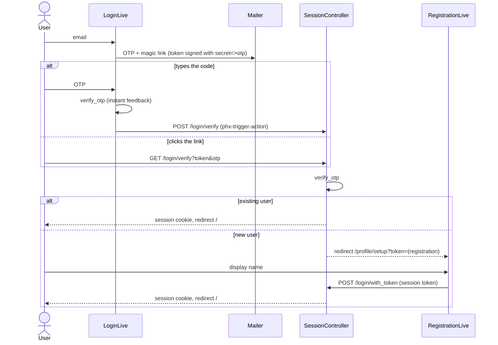
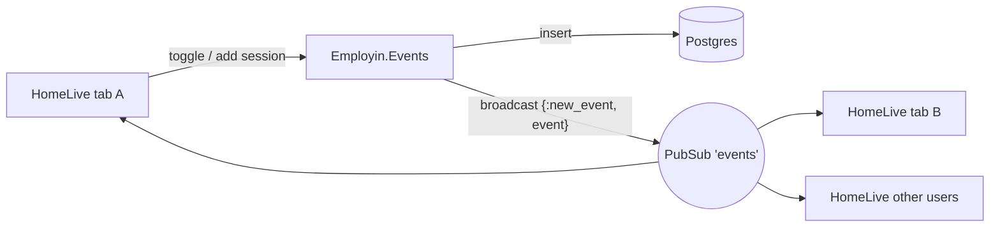

# Architecture

Employin is a standard Phoenix application. The domain code (`lib/employin`) knows
nothing about the web, and the web layer (`lib/employin_web`) is a thin LiveView
UI on top of it.

## Module map

```
lib/
├── employin/                       # domain
│   ├── contexts/
│   │   ├── events.ex               # Employin.Events: queries, commands, PubSub
│   │   ├── events/event.ex         # schema + past-session form changeset
│   │   ├── users.ex                # Employin.Users
│   │   └── users/user.ex           # schema, email/display-name validation
│   ├── login_token.ex              # purpose-bound signed tokens + OTP
│   ├── mail_notifier.ex            # login email (HTML + text)
│   ├── schema.ex                   # UUIDv7 primary keys, utc_datetime timestamps
│   └── release.ex                  # `bin/migrate` for releases
└── employin_web/                   # web
    ├── router.ex                   # live_sessions :guest / :authenticated
    ├── user_auth.ex                # plugs + on_mount hooks
    ├── controllers/session_controller.ex
    ├── components/
    │   ├── core_components.ex      # inputs, modal, flash, icon, spinner, status_dot
    │   └── auth_components.ex      # auth_card, submit_button
    └── live/
        ├── home/                   # HomeLive + HomeComponents
        ├── login/                  # LoginLive (email → OTP)
        └── registration/           # RegistrationLive (display name)
assets/js/
├── app.js                          # LiveSocket, sends the browser's tz offset
└── hooks/                          # ActivityLog, OtpCountdown, AutoDismissFlash
```

## Authentication flow

Login is passwordless and **stateless**: nothing is stored server-side until the
session cookie is set. `Employin.LoginToken` signs tokens with `Phoenix.Token`.
Each token is bound to a purpose by its salt, so a token issued for one step
can't be replayed in another.

| Purpose         | Payload | Lifetime | Notes |
|-----------------|---------|----------|-------|
| `:otp`          | email   | 5 min    | Signing key is `secret <> otp`, so the token verifies only with the emailed code |
| `:registration` | email   | 10 min   | Proves the email was verified; carried to the profile setup page |
| `:session`      | user id | 60 s     | Hands a new user from the LiveView to the controller to set the cookie |



The session stores only `user_id`. `UserAuth` resolves it in a plug for controllers
and in `on_mount` for LiveViews, so a deleted user can no longer use the app.
Logout is a `DELETE` request. It clears the session and broadcasts `disconnect`
to the user's open LiveViews.

The LiveView throttles resending the OTP (`@resend_cooldown`). The JS countdown
only reflects that cooldown in the UI.

## Events

An event is `{user_id, type: "joined" | "left", time, tags}`. A user's events
alternate `joined → left → joined …` in time, and the latest event decides
whether the user is working.

- **Quick toggle**: `Events.toggle_status/2` reads the latest event and inserts
  the opposite type at "now". A new session uses the selected location. Ending
  a session keeps the running session's location.
- **Past sessions**: `Events.create_work_session/4` inserts a `joined`/`left`
  pair after `slot_available?/3` checks three things:
  - no events of the user fall inside the range,
  - the event before the range is a `left` (or there is none),
  - the event after the range is a `joined` (or there is none).
  `Event.session_form_changeset/3` already checks that the end is after the start
  and not in the future.

Both commands run in a transaction that first takes
`pg_advisory_xact_lock(hashtext(user_id))`. Writes for one user are serialized,
so two tabs can't both start a session or create overlapping ranges.

`events.time` is `NOT NULL` and indexed as `(time)` and `(user_id, time)`.
The activity log uses **keyset pagination** on `(time, id)` (`list_events(before: …)`).
New rows arriving at the head don't shift pages the way `OFFSET` would.

### Timezones

All times are stored in UTC. The browser sends its UTC offset in minutes as a
LiveView connect param (`tz_offset`). It is used to:

- render times and day dividers in the viewer's local time,
- default the past-session form to the viewer's local date,
- convert the form's local date/time inputs to UTC.

A fixed offset ignores DST changes between "now" and the session's date. See the
roadmap for IANA timezone support.

## Real-time updates



`Employin.Events` broadcasts after a successful commit. The LiveView never
broadcasts, so every write path behaves the same. Each `HomeLive`:

- updates its status card when the event belongs to the current user. This keeps
  several tabs of the same user in sync.
- adds the event to the log if it falls inside the loaded window, marked as
  `fresh?` so only live events get the highlight animation.

## Frontend

The UI is server-rendered with LiveView and styled with Tailwind:

- **Function components**: `HomeComponents` renders the page pieces
  (`app_header`, `activity_log`, `event_item`, `date_divider`, `status_card`,
  `session_form`). `HomeLive` keeps only state and event handlers.
  `AuthComponents` gives the login and registration pages a shared shell.
- **Forms**: one `<.input>` component (from `CoreComponents`) gives every input
  the same styling, label and error handling, including disabled and error states.
- **JS hooks** (`assets/js/hooks/`), kept small and single-purpose:
  - `ActivityLog` keeps the log pinned to the newest entry and loads older pages
    near the top. One request is in flight at a time, and it stops when the
    server replies `more: false`. It keeps the reading position when older entries
    are inserted above, and toggles the scroll-to-bottom button.
  - `OtpCountdown` displays the resend cooldown.
  - `AutoDismissFlash` hides info flashes after 5 seconds.

## Testing

- `test/employin/`: context tests. They cover token purposes and expiry, OTP
  format, the alternation and overlap rules, keyset pagination, broadcasts and
  the timezone conversion of the session form.
- `test/employin_web/`: controller and LiveView tests. They walk through the full
  login → registration → session flow (`follow_trigger_action`), the resend
  throttle, start/end work, past sessions with overlap errors, live updates and
  "load more".

CI (`.github/workflows/ci.yml`) runs formatting, compilation with
`--warnings-as-errors` and the test suite against Postgres.
